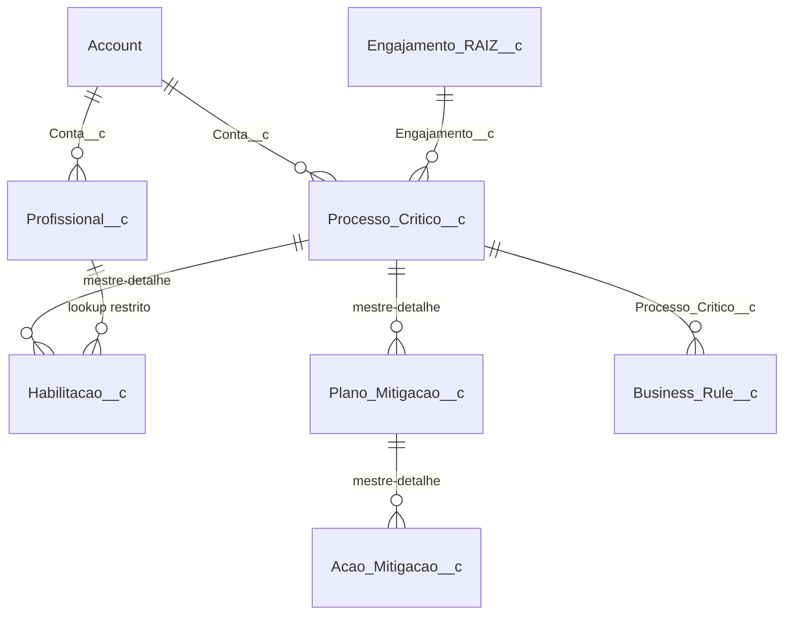
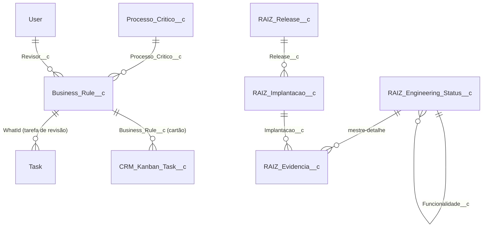

# Arquitetura

## Modelo de dados



## Cálculo da cobertura

| Campo (`Processo_Critico__c`) | Regra |
|---|---|
| `Habilitacoes_Registradas__c` | Roll-up: total de habilitações |
| `Aptos_Habilitados__c` | Roll-up: habilitações com status Apto |
| `Aptos_Efetivos__c` | Habilitações, se houver; senão o declarado (`Pessoas_Aptas__c`); senão em branco |
| `Estado_Cobertura__c` | 0 = Sem cobertura · 1 = Ponto único · 2+ = Coberto · branco = Informação insuficiente |
| `Ponto_Unico_de_Falha__c` | Aptos efetivos ≤ 1 (insuficiente não é ponto único) |
| `Exposicao_Financeira__c` | Impacto/hora × horas para restabelecer, só em ponto único |
| `Exposicao_Completa__c` | Falso quando é ponto único sem impacto/hora ou horas |
| `Risco_Score__c` | Criticidade (4/3/2/1) × dependência (3 ponto único ou insuficiente; 2 com dois aptos; 1 com três ou mais) × desatualização (1 ou 2) |
| `Farol__c` | Crítico 16+, Alto 9–12, Médio 6–8, Baixo até 4 |

`RaizRiskEngine` reproduz as mesmas regras em Apex para cálculos hipotéticos (simulador, planos). O teste de contrato compara fórmula e motor em 120 combinações; se um mudar sem o outro, o deploy falha.

## Camadas

| Camada | Classes | Responsabilidade |
|---|---|---|
| Domínio puro | `RaizRiskEngine` | Regras de risco, sem SOQL nem DML |
| Gatilhos | `RaizHabilitacaoHandler`, `HabilitacaoTrigger`, `ProfissionalTrigger`, `AcaoMitigacaoTrigger` | Chave única processo/profissional, vencimento na gravação, suspensão de inativos, data de conclusão de ação |
| Assíncrono | `RaizHabilitacaoVencimentoJob` | Diário 05:00: vence habilitações expiradas (filtro de roll-up não aceita `TODAY()`) |
| Serviços (API do LWC) | `RaizCockpitService`, `RaizSimulationService`, `RaizMitigationService`, `RaizKnowledgeService` | Leitura `WITH USER_MODE`, escrita `AccessLevel.USER_MODE`, erros traduzidos para o usuário |
| Interface | 4 LWCs em tema escuro | Estados de carregando, vazio, erro e sem permissão em todos |

## Qualidade (último deploy)

| Classe | Cobertura |
|---|---|
| RaizMitigationService | 99% |
| RaizRiskEngine | 98% |
| RaizSimulationService | 98% |
| RaizCockpitService | 96% |
| RaizKnowledgeService | 96% |
| RaizHabilitacaoHandler | 94% |
| RaizHabilitacaoVencimentoJob | 94% |
| Gatilhos (3) | 100% |

55 métodos de teste Apex e 17 testes Jest, todos passando.

## Permissões

| Permission set | Papel |
|---|---|
| `EBL_RAIZ_Cockpit` | Autor/gestor: lê e escreve em todos os objetos do método; envia documento para revisão |
| `RAIZ_Aprovador` | Soma a permissão `RAIZ_Aprovar_Documentos` (aprovar e publicar) |
| `RAIZ_Leitor` | Somente leitura de todos os módulos |

---

# RAIZ 4.0 — o que entrou depois da Onda 5

## Modelo de dados (novo)



`RAIZ_Log_Execucao__c` não tem relacionamento: guarda o Id do registro tratado em `Registro_Id__c` e uma chave de idempotência em `Chave__c`.

## Fluxo da governança documental

```
Cadastro guiado ──salvar e encaminhar──┐
Knowledge Hub ──"Mover para Em revisão"┤
                                       ▼
          Business_Rule__c.Status__c passa a "Em Analise"
                                       │
             Flow RAIZ_Governanca_Revisao (só roteia)
           ┌───────────────────────────┴──────────────────────────┐
     caminho imediato                                 caminho agendado
 RaizGovernancaAction.submeter               1 dia após Prazo_Revisao__c
   avaliarSubmissao (RaizGovernancaService)   RaizGovernancaAction.escalar
   ├─ completo → Task do revisor,                (uma vez; prioridade alta,
   │   cartão do Kanban, notificação, log         aviso a revisor e autor)
   └─ incompleto → "Bloqueado: falta …",
       aviso ao autor, log, cartão no Backlog
```

Ao aprovar, publicar ou devolver no Hub, `RaizGovernancaAction.aoMudarStatus` encerra a tarefa de revisão e move o cartão.

## Segurança

| Camada | Regra |
|---|---|
| Telas e serviços de leitura | `with sharing` e `WITH USER_MODE`; escrita com `AccessLevel.USER_MODE` |
| Automação, log e verificador | `without sharing`, de propósito (ADR-018); nunca alteram status, dono ou conteúdo |
| Campos que só a automação grava | `Governanca_Status__c`, `Data_Solicitacao_Revisao__c`, `Escalonado_Em__c`, `Estado_Validacao__c`: somente leitura nos permission sets |
| Permission sets | `EBL_RAIZ_Cockpit` (autor) · `RAIZ_Aprovador` (aprovar/publicar) · `RAIZ_Leitor` (só leitura) · `RAIZ_Engenharia` (gravar evidências, implantações e releases) |
| Integração | Named Credential sem segredo; somente GET; log sem cabeçalho nem corpo bruto |

## Verificação (Engineering Status)

| Tipo de item | Como o verificador confere |
|---|---|
| Objeto / Campo | `Schema.getGlobalDescribe()` e o mapa de campos |
| Classe Apex / Trigger | `ApexClass`, `ApexTrigger` (status Active) |
| Flow | `FlowDefinitionView.IsActive` |
| Permission Set / Job / Aba / App / Notificação / Named Credential | `PermissionSet`, `CronTrigger`, `TabDefinition`, `AppMenuItem`, `CustomNotificationType`, `NamedCredential` |
| Teste associado | última execução em `ApexTestResult` sem falha |
| LWC e cobertura | Apex não enxerga: evidência do sf CLI (Tooling API), válida por 7 dias |
